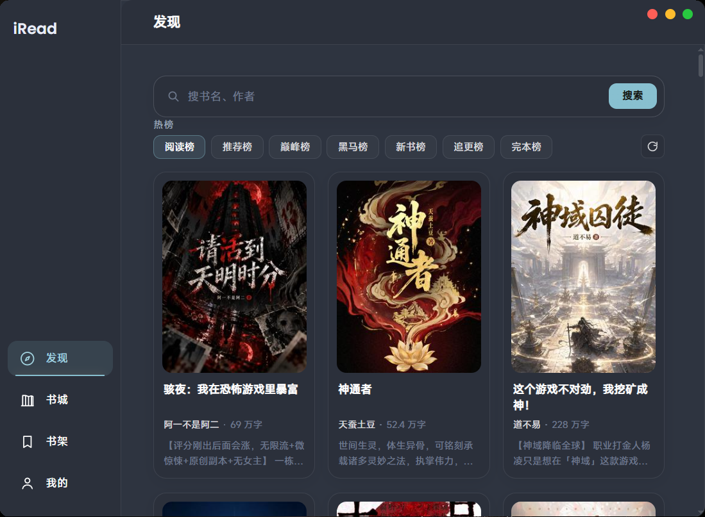
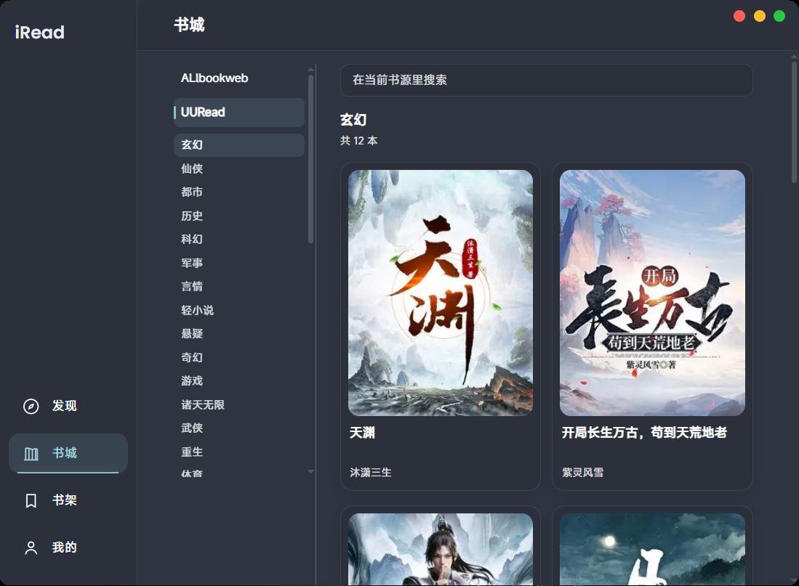
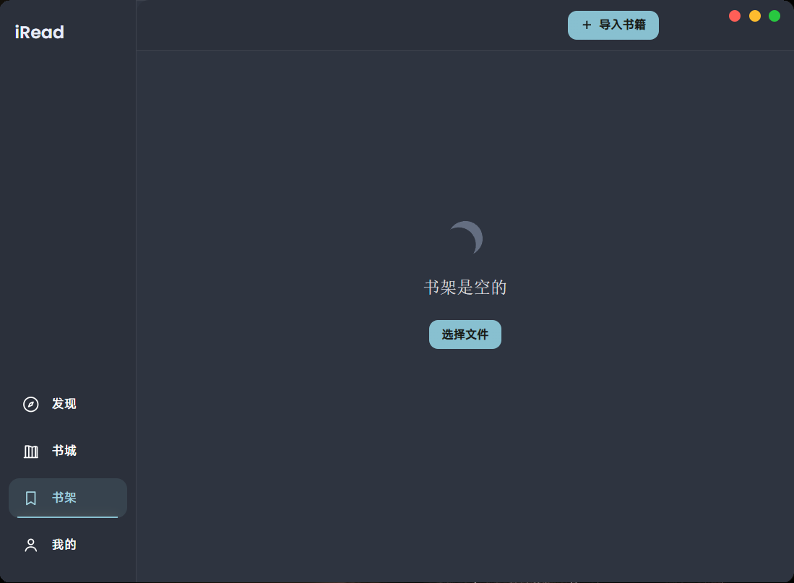
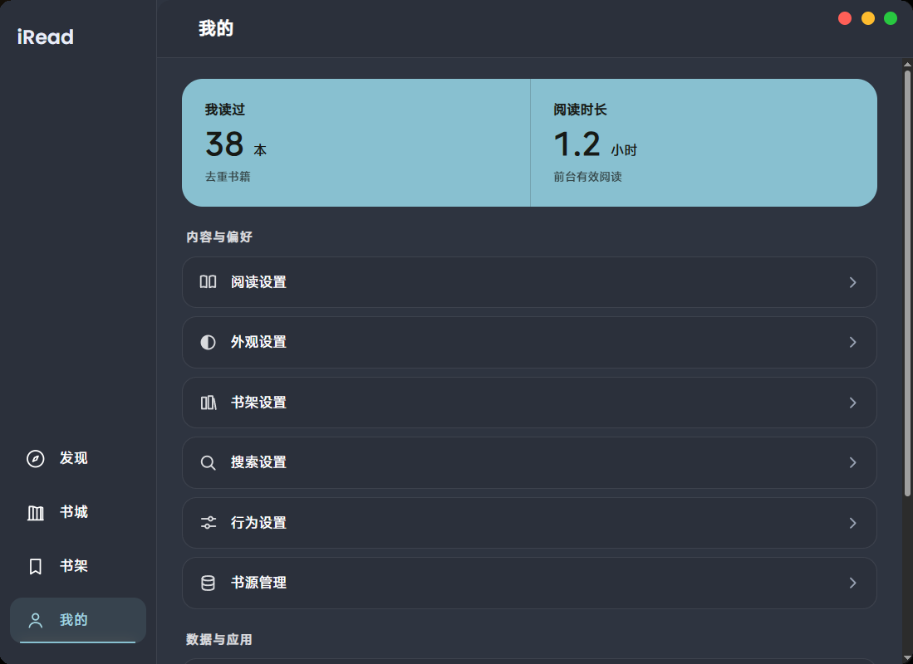

# iread

Windows 桌面阅读器。界面为纯 HTML/CSS/JS，运行在 WebView2 中；书源采用 Legado（阅读 3.0）方言子集，规则在独立 worker 进程执行；mkv / HEVC 由宿主拉起的 mpv 子进程渲染。

**TL;DR** — A Windows reader on WebView2. UI is plain HTML/CSS/JS. Book sources are Legado-dialect rule JSON executed in a separate worker process. Video: `<video>` + hls.js for mp4/m3u8, an mpv child process for mkv/HEVC. Sources and plugins are user-supplied; the repository ships neither content nor plugins.

---

<p align="center">
  
  
</p>
<p align="center">
  
  
</p>

## 功能

| 模块 | 能力 |
| --- | --- |
| 本地阅读 | txt / epub 导入，分章、编码识别、进度、排版与主题 |
| 在线书源 | Legado 方言 JSON，搜索 / 发现 / 目录 / 正文 |
| 书城 / 热榜 | 分类浏览与榜单 |
| 视频 | mp4 / m3u8 原生播放，mkv / HEVC 走 mpv，m3u8 广告段剔除 |
| 漫画 | 图片序列渲染，整话滚动 |
| 插件运行时 | 目录加载、六个插槽、命令面板、zip 导入 |

## 不包含

- 不提供、不托管、不分发任何书籍 / 漫画 / 影视内容。
- 不带书源，不带插件，不带任何站点账号或密钥。
- 无账号体系、云同步、遥测。

## 安装

到 [Releases](https://github.com/Silencecavalier/iread/releases) 取最新安装包。

| 文件 | 说明 |
| --- | --- |
| `iread-setup.exe` | Windows 10/11 x64 安装包，自带 .NET 8 运行时 |

> **WebView2**：Win11 自带；Win10 由安装包检测并引导安装微软官方运行时。

## 从源码构建

前置：Windows 10/11、[.NET 8 SDK](https://dotnet.microsoft.com/download)、WebView2 Evergreen Runtime。

```bash
git clone https://github.com/Silencecavalier/iread.git
cd iread
bash scripts/build-desktop.sh
# → dist/publish/iread-plugin.exe（自包含，免装 .NET）
```

安装包（需 [NSIS 3.x](https://nsis.sourceforge.io/)）：

```bash
NSIS=/c/Program\ Files\ \(x86\)/NSIS/makensis.exe bash scripts/build-desktop.sh --installer
# → dist/iread-setup.exe
```

渲染层为静态文件，修改 CSS / JS 无需重编译 C#：覆盖到程序目录的 `wwwroot/` 后重启。

## 目录

```
src/Iread.Desktop/     C# 宿主：窗口 / WebView2 / HostFetch / 规则 worker / mpv 面板 / IPC
src/Iread.Renderer/    渲染层：index.html + css/ + js/ + assets/
docs/                  书源写法、插件开发指南、架构说明、截图
scripts/               构建脚本与 NSIS 脚本
tools/                 调试工具：fixture 测试站、CDP 求值
LICENSES/              第三方许可全文
```

## 书源

[`docs/书源写法兼容说明.md`](docs/书源写法兼容说明.md) 说明本子集与标准 Legado 的差异：支持的选择器、`@js:` 的可用范围、空实现的函数，以及 `NO_RULE` / `NO_NODES` / `EMPTY_FIELDS` / `EMPTY_TOC` / `EMPTY_CONTENT` / `UNSUPPORTED` 各自的含义。

调试建议：先 `node tools/fixture-server.js` 起本地测试站，用内置「示例 · 本地演示站」书源对着 `127.0.0.1:8123` 验证链路，再改为真实站点。

规则在 worker 中执行，桌面端只呈现摘要错误；完整的 `cause / textLen / traces` 需走页面内调试通道，见 `docs/ARCHITECTURE.md`。

## 插件

[`docs/插件开发指南.md`](docs/插件开发指南.md)。插件 = 一个目录 + `manifest.json` + `main.js`，放置于数据目录 `plugins/<id>/`，或以 zip 导入。

> ⚠️ 运行时无 iframe 隔离。`net / ui / store / commands / events / shelf:read / shelf:write` 七项权限为声明式，不做运行时拦截。安装第三方插件等同于允许其在页面上下文执行代码。

本仓库仅包含插件运行时（`js/plugins.js` 与六个插槽），不包含任何插件实现。

## 内置 mpv

WebView2 缺少 HEVC 解码器，mkv / HEVC 由宿主拉起 mpv 子进程，以 `--wid` 嵌入窗口面板，控制栏仍由网页绘制。

- 首次播放该类视频时下载至 `<数据目录>\mpv\`，此后不再联网。
- 下载失败或不需要时，播放页提供「复制直链」退回外部播放器。
- mpv 为 GPLv2+ 独立程序，本项目仅调用，不打包、不修改、不链接。见 `THIRD-PARTY-NOTICES.md`。

## 已知限制

- 规则覆盖率受方言子集限制，复杂 JS 书源会降级或失败。
- 规则在独立进程执行，桌面端调试不如页面内直接执行方便。
- 自包含发布首次启动需解压，冷启动 3~5 秒。
- 视频站点广告规则依赖 m3u8 结构，站点改版即失效。
- 数据目录名保留历史命名 `iread-plugin-data`；更名将导致用户数据被视为丢失，故不改。

## 许可

代码 MIT，见 [`LICENSE`](LICENSE)。第三方组件（hls.js / Poppins / WebView2 / .NET / mpv）见 [`THIRD-PARTY-NOTICES.md`](THIRD-PARTY-NOTICES.md)。

本仓库不含任何书籍、漫画、影视内容，也不含站点账号或密钥。用户自行添加的书源所涉内容与版权与本项目无关，见 [`DISCLAIMER.md`](DISCLAIMER.md)。
